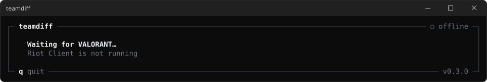
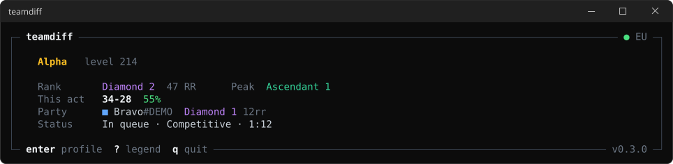
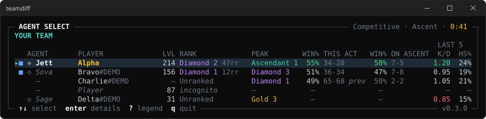
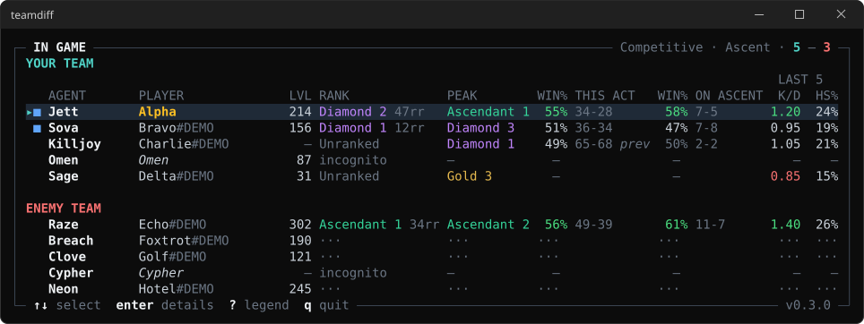
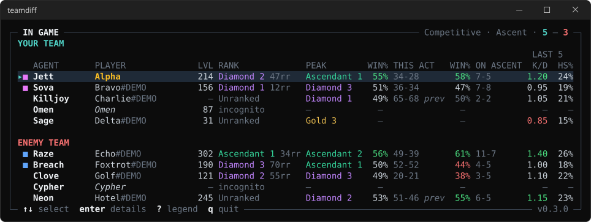
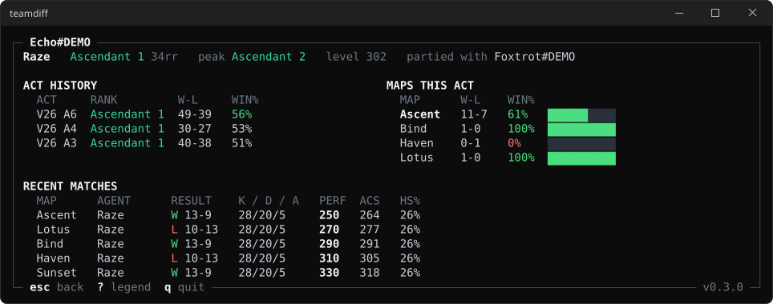
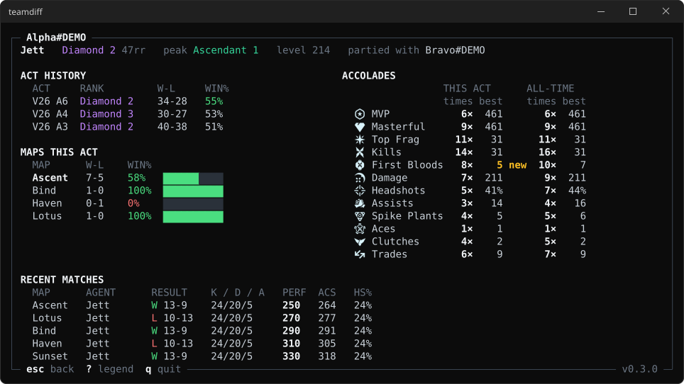
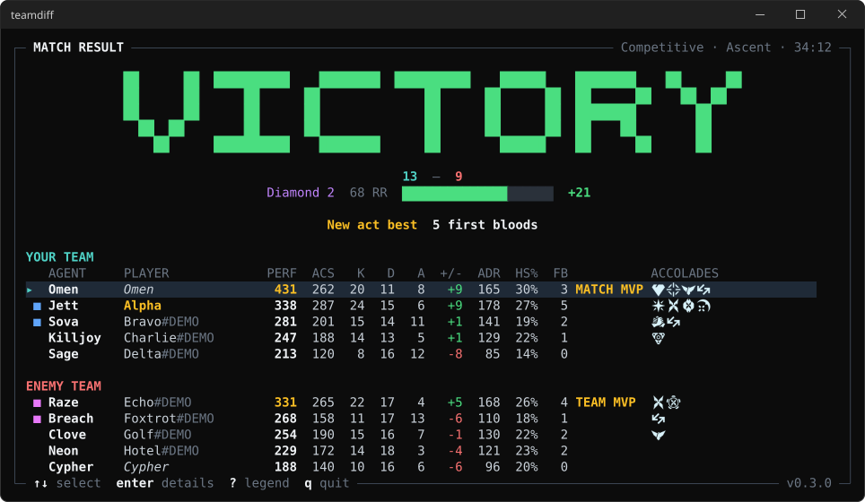
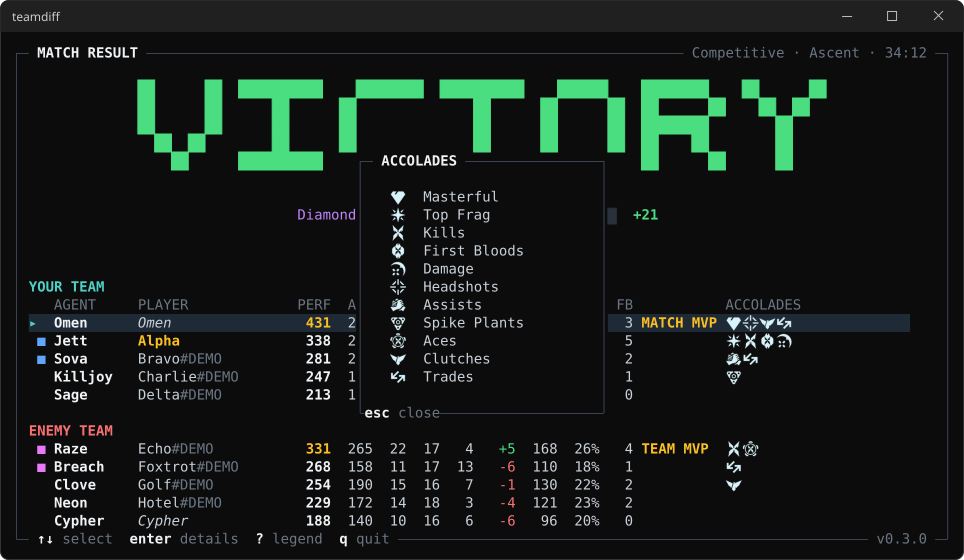
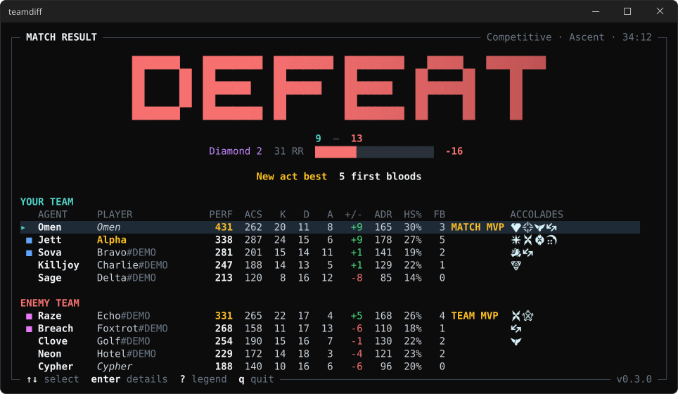

# Use teamdiff

Read this page to run teamdiff during a match and to know what each key and option does.

## Run it

1. Start VALORANT.
2. Run `teamdiff.exe` from Windows Terminal or another terminal.

teamdiff reads the Riot Client running on your PC and follows your lobby through the menus, agent
select, the match and the post-game screen. Only competitive matches are tracked for now.

The terminal needs to be at least 112 columns wide, and tall enough for the screen it shows;
teamdiff says how many rows it needs. Windows Terminal, WezTerm and VS Code's terminal draw the
accolades as the game's icons when they can show images; other terminals show two-letter labels.

tracker.gg stats load through the Microsoft Edge WebView2 Runtime, which comes with Windows 11. On
Windows 10, install it from [Microsoft](https://developer.microsoft.com/microsoft-edge/webview2/)
if it's missing.

In a match, Riot shares party details only for you and your friends, so other parties are worked
out from tracker.gg: players who partied in either one's last match, which needs only one of them
to have a public profile, or who were teammates in at least 2 of their last 20 matches. Incognito
players are never tied to a party, and a party whose other members are private goes unmarked until
the post-game screen, which takes parties from Riot's match details.

## Keys

| Key | Action |
| --- | --- |
| ↑ ↓ (or `k` `j`) | Select a player |
| Enter | Player details (your own row opens your profile) |
| ? | Accolade legend |
| Esc | Back |
| q (or Ctrl+C) | Quit |

## Options

| Option | What it does |
| --- | --- |
| `--demo [screen]` | Shows made-up players without connecting to anything. Tab cycles through the screens. Name one of `waiting`, `menus`, `agent-select`, `loading`, `in-game`, `victory` or `defeat` to start on it. It can't be combined with `--dump`. |
| `--no-update` | Doesn't install new releases by itself. |
| `--dump <dir>` | Saves raw API responses under `<dir>`, for checking field names (see below). |
| `--licenses` | Prints the licenses of the open-source code teamdiff is built with. A build you make yourself prints a note saying how to include them. |
| `-V`, `--version` | Prints teamdiff's version, which the window's bottom-right corner also shows when nothing else is there. |
| `-h`, `--help` | Shows the help. |

## Updates

A release build of teamdiff keeps itself up to date. When it starts, and every hour while it runs,
it asks GitHub for the latest release. It downloads a newer `teamdiff.exe`, checks that this
repository's release workflow built it, and puts it in place of the old one. The footer then says
the new version runs when you restart teamdiff, and after the restart it links the release notes.
Keep `teamdiff.exe` in a folder you can write to, such as one under your user folder, so it can
update. To stop updates, run `teamdiff --no-update`. A build you make yourself never updates
itself.

teamdiff 0.2.1 and earlier came from the repository now named
[teamdiff-old](https://github.com/265866/teamdiff-old), and only trust releases built there. When
this repository publishes a release, their footer says
`couldn't verify the download of teamdiff <version>`: they refuse it, as they should, and keep
running as they are. Update such a copy once by hand:

1. Close teamdiff.
2. Download `teamdiff-<version>-x64.zip` from the
   [latest release](https://github.com/265866/teamdiff/releases/latest) and check it as
   [Verify a release](verifying-releases.md) shows.
3. Unzip it and put its `teamdiff.exe` in place of the old one, in the same folder.

From then on teamdiff updates itself again.

## Checking unconfirmed fields

Riot obfuscates some keys in its responses: the Performance Score in match details
(`scores.TempValueF`) and the accolade response. A patch can rename them. To capture real
responses, run teamdiff with a folder outside any repository:

```powershell
teamdiff --dump $env:TEMP\teamdiff-responses
```

Your and your friends' presences, the responses of Riot's game servers, and tracker.gg's player
pages are then saved in that folder. The lobbies of agent select and the match aren't saved, since
they carry what the game hides, and neither are tracker.gg's match pages, which name incognito
players. The files hold real players' data, so never commit them or paste them into an issue.

## Screenshots

Each screenshot is a screen of `teamdiff --demo`, so every player, rank and number in it is made
up. They show teamdiff in a terminal that draws images, such as Windows Terminal; other terminals
show two-letter labels in place of the accolade icons. Select an image to see it at full size.

| Screen | Screenshot |
| --- | --- |
| **Waiting:** before VALORANT starts, while the Riot Client isn't running | [](screenshots/waiting.svg) |
| **Menus:** your rank, this act's record, your party, and how long you've been in the queue | [](screenshots/menus.svg) |
| **Agent select:** your team as they hover and lock agents; the enemy team stays hidden | [](screenshots/agent-select.svg) |
| **Loading:** the match has started, and the enemy team's stats are still loading | [](screenshots/loading.svg) |
| **In game:** both teams, the score, and the parties | [](screenshots/in-game.svg) |
| **Player details:** Enter on a player opens their act history, maps this act and recent matches | [](screenshots/player-details.svg) |
| **Your profile:** Enter on your own row also shows your accolades this act and all-time | [](screenshots/profile.svg) |
| **Victory:** your RR change, new act bests, and the scoreboard ordered by Performance Score | [](screenshots/victory.svg) |
| **Accolade legend:** `?` names each accolade icon | [](screenshots/legend.svg) |
| **Defeat:** the same screen after a loss | [](screenshots/defeat.svg) |
